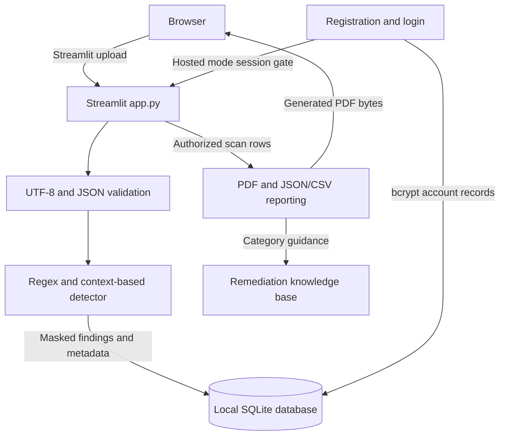

# Architecture

DataSniff is currently a single-process Streamlit application. There is no separate frontend service, REST ingestion API, external database, or AI provider.

## Scan flow

Uploads are limited to `.log`, `.txt`, and `.json` files at 5 MB. The Streamlit process decodes and scans the contents in memory; it does not execute uploaded content. JSON is parsed and formatted before line-based detection. The detector stores masked evidence, filename, timestamp, size, and finding metadata. Raw uploaded file contents are not written to SQLite.

## Storage and authorization

`DATASNIFF_DB_PATH` can choose the SQLite file; by default it is `datasniff.sqlite3` beside the application and is excluded from Git. Local mode keeps scans available without login. Hosted mode requires an authenticated Streamlit session and filters scan history and report choices by account owner ID. Existing owner-less rows remain accessible only in local mode.

Accounts store bcrypt password hashes, not plaintext passwords. Authentication lockout is per email after five failures for 15 minutes. Session state is maintained by Streamlit server-side for the active browser session. Password reset and email verification are not implemented.

## Reporting flow

The report service reads the persisted scan finding schema and applies deterministic category guidance from `services/reporting/remediation_knowledge_base.py`. It creates a PDF in memory using ReportLab, sanitizes user-controlled text, masks evidence, derives counts and risk summaries from the findings, and returns bytes for download. Report PDFs are not separately archived.
